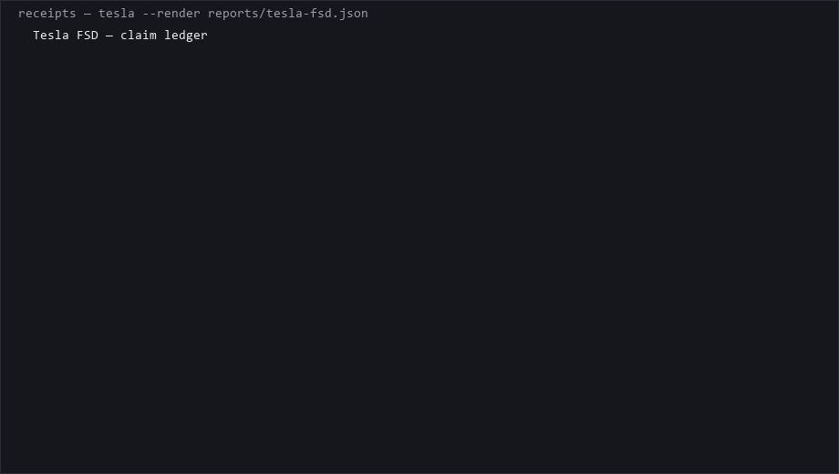

# Receipts

**What a vendor claims, what independent sources report, and which claims nothing corroborates.**

Receipts reads a vendor's own pages and independent writing about it (status pages, Hacker News, Wikipedia, regulators, issue trackers) and produces a claim ledger. A model proposes which claims contradict which. A deterministic gate then searches for every quote in the bytes that were actually fetched, and **discards anything it cannot find**. The model organises; the sources speak.

Live ledgers: [Tesla FSD](https://kristiankrattiger.github.io/receipts/tesla-fsd.html) · [Claude](https://kristiankrattiger.github.io/receipts/claude.html) · [Vercel](https://kristiankrattiger.github.io/receipts/vercel.html) · [Chime](https://kristiankrattiger.github.io/receipts/chime.html)



## One row

```
FSD makes roads safer  [FSD road safety]  provisional
  tesla       Tesla FSD page
    "Tesla uses billions of miles of anonymous real-world driving data to
    train Full Self-Driving (Supervised) to take care of the most stressful
    parts of daily driving while helping make the roads safer for you and
    others."
  independent NHTSA recalls — Tesla Model 3 2023
    "FSD Beta software that allows a vehicle to exceed speed limits or
    travel through intersections in an unlawful or unpredictable manner
    increases the risk of a crash."
```

Both quotes are verbatim. [`reports/tesla-fsd.json`](reports/tesla-fsd.json) records each one's character offsets in a committed snapshot, so anyone can slice them out and check.

## The guarantee, and what it costs the model

- **Quotes are found, not trusted.** `admit()` re-derives every quote as an exact substring of the fetched text ([`anchor.ts`](src/assay/bookkeeper/anchor.ts)). Thirteen typed denial codes, such as `ANCHOR_NOT_FOUND`, `SELF_SOURCED` and `FROM_NOT_CLAIMANT`, are printed on every ledger's audit line, so the guarantee is checkable rather than claimed.
- **An aggregator is a conduit, not a source.** A Hacker News post linking to the vendor's own domain is denied as `SELF_SOURCED`. The gate enforces this whether or not the model complied.
- **Same measure, or no relation.** `--relation-check` has a second model judge whether two quotes measure the same property before a relation can admit (`NOT_SAME_MEASURE`). On the Tesla ledger it cut 16 rows to 8. It is off by default because it failed its eval bar on positives.
- **Unverified is a finding.** A vendor claim nothing corroborates gets its own section instead of silently disappearing.
- **Partial coverage is stated.** A source that refuses (Reddit, G2) is listed as `not read`, with its reason. Captcha solving is off unless you pass `--captcha`.
- **Refusal is a result.** A plan with only one side is refused (`CORPUS_INSUFFICIENT`) before any model call or spend.

The engine, **Assay** (`src/assay/`), is pure: pinned documents and a subject in, a ledger or a typed refusal out. It never fetches, never touches the filesystem, and never imports a model SDK. [`isolation.test.ts`](src/assay/isolation.test.ts) fails the build if that ever changes. A second field instance, [Claim/Record](https://github.com/KristianKrattiger/claim-record), points the same engine at two uploaded piles of legal text.

## Run it

```bash
npm install
npm test                                   # 846 tests, no network, no key
npm run replay                             # rebuild all four committed ledgers from their bytes: no network, no model, no key
npm run cli -- tesla --render reports/tesla-fsd.json
```

A live run needs `SOLARI_API_KEY` plus a proposer: `ANTHROPIC_API_KEY`, or `--client ollama` for a local model at zero cost, or `--client sear` for GIN's decode-time-constrained proposer.

## Where the rest is

- [**The full account**](docs/full-account.md) has every ledger, measurement, reversal and caveat: proxy egress, source-class probes, what a pin is, cost, refresh and replay.
- [**Architecture**](architecture.md) covers the pipeline, the admission codes, outcomes and pins.
- Design history lives in [`docs/superpowers/specs/`](docs/superpowers/specs/).

Built for the Pinetree Research challenge on [Solari](https://getsolari.com) cloud browsers, starting from a fork of the Solari cookbook. MIT licensed.
